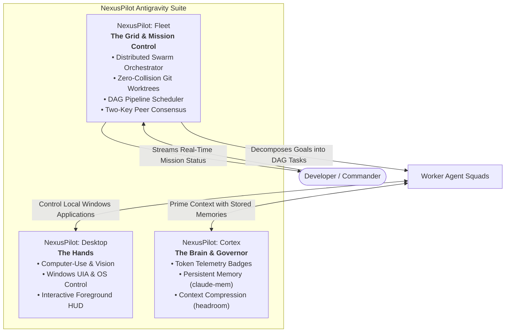
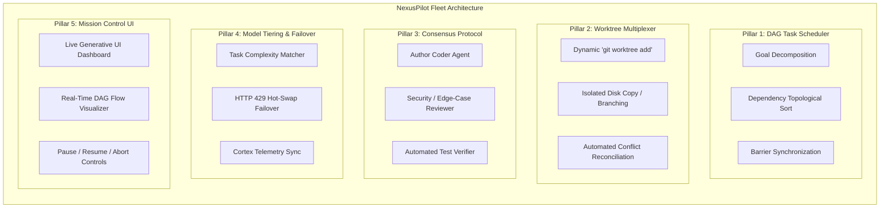
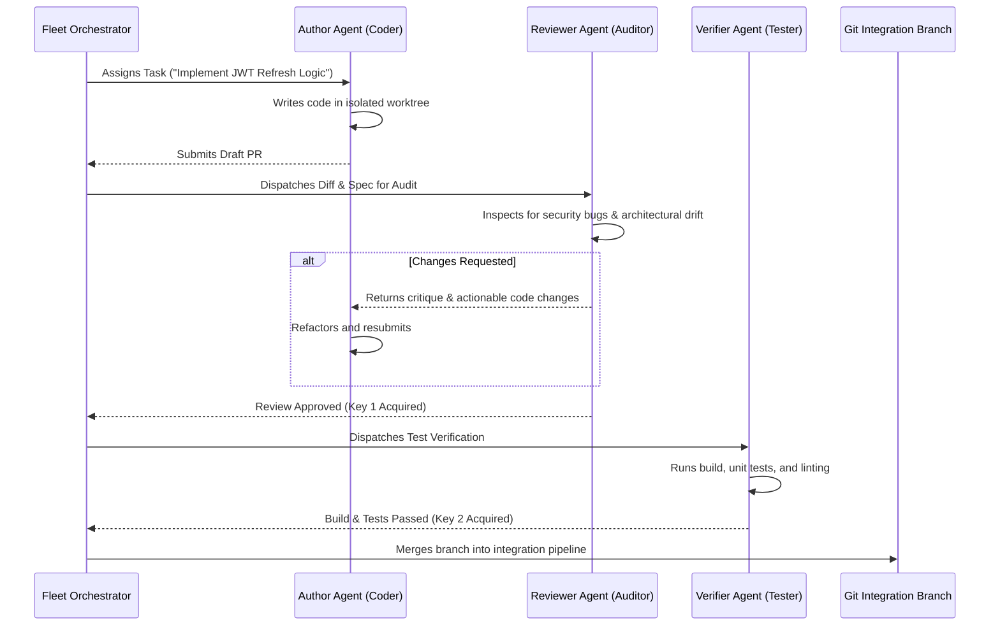
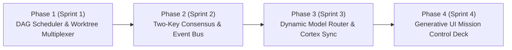

# Product Requirements Document (PRD)

## NexusPilot: Fleet (Distributed Multi-Agent Swarm Orchestrator & Mission Control)
**Component of the NexusPilot Antigravity Suite**  
**Document Version:** 1.0.0  
**Target Platform:** Google Antigravity (Antigravity 2.0 / CLI / IDE), Claude Code, Cursor, Windsurf, MCP  
**Status:** Approved for Implementation  

---

## 1. Executive Summary & Ecosystem Vision

### 1.1 The Multi-Agent Scaling Problem
Current AI coding tools operate like a single developer sitting at a single keyboard. When a user requests large-scale tasks—such as refactoring an entire monolithic codebase across 150 files, migrating an API framework, or writing an end-to-end integration test suite—a single agent faces fatal limitations:
1. **Context Window Exhaustion:** As conversation length increases, latency degrades, costs skyrocket, and earlier constraints are forgotten.
2. **Sequential Execution Bottleneck:** Tasks that could easily be parallelized across 5–10 independent workers take hours when executed serially by a single agent loop.
3. **Merge Collisions & Workspace Contention:** If multiple agent processes attempt to edit the same working tree simultaneously, file lock conflicts, git race conditions, and corrupted source trees occur.
4. **Lack of Peer Review & Consensus ("Single-Agent Blindness"):** A single agent tends to reinforce its own hallucinations or miss edge cases when reviewing its own code.

### 1.2 The NexusPilot Ecosystem Trilogy
**NexusPilot** is the unified open-source ecosystem that provides complete autonomy, cognitive efficiency, and distributed scaling for Google Antigravity:



`NexusPilot: Fleet` coordinates multi-agent squads working in parallel on isolated git worktrees, validates code through peer review and consensus protocols, and surfaces real-time progress via a Generative UI Mission Control dashboard.

---

## 2. Product Identity & Metadata

| Attribute | Specification |
| :--- | :--- |
| **Plugin ID** | `nexus-pilot-fleet` |
| **Display Name** | `NexusPilot Fleet: Multi-Agent Swarm Orchestrator` |
| **Version** | `1.0.0-preview` |
| **Category** | Multi-Agent Systems / Developer Tools / Swarm Orchestration |
| **Compatibility** | Google Antigravity 2.0+, Claude Code CLI, Cursor IDE, Windsurf, MCP 2.x |
| **Core Architecture** | Dual Node.js NPX Bootstrapper + Python FastMCP/MCPServer Core |
| **License** | Apache 2.0 |

---

## 3. Core Pillars & Functional Requirements



---

### Pillar 1: Directed Acyclic Graph (DAG) Task Decomposer & Pipeline Engine

#### FR-1.1: Autonomous High-Level Goal Decomposition
The user specifies a high-level directive (e.g., *"Refactor all 35 REST controller endpoints to Fastify with Zod schema validation and add unit tests"*). Fleet automatically decomposes the request into a structured Directed Acyclic Graph (DAG) with explicit dependencies:
```json
{
  "mission_id": "msn_01hk9...",
  "goal": "Migrate REST controllers to Fastify with Zod",
  "nodes": [
    { "task_id": "T1", "name": "Extract Shared Types & Zod Schemas", "dependencies": [] },
    { "task_id": "T2", "name": "Migrate Auth & User Controllers", "dependencies": ["T1"] },
    { "task_id": "T3", "name": "Migrate Billing & Invoice Controllers", "dependencies": ["T1"] },
    { "task_id": "T4", "name": "Migrate Inventory & Catalog Controllers", "dependencies": ["T1"] },
    { "task_id": "T5", "name": "Integration Test Suite & Regression Verification", "dependencies": ["T2", "T3", "T4"] },
    { "task_id": "T6", "name": "Update OpenAPI / Swagger Specs", "dependencies": ["T5"] }
  ]
}
```

#### FR-1.2: Topological Scheduling & Parallel Barrier Synchronization
- Fleet evaluates the DAG dependency matrix and dispatches tasks whose dependencies are resolved concurrently.
- Tasks `T2`, `T3`, and `T4` execute in parallel across independent workers.
- Fleet maintains **Barrier Synchronization**: downstream tasks (e.g., `T5`) will not start until all prerequisite branches pass consensus verification.

#### FR-1.3: Fault Recovery & Retry Policies
- If a task node fails verification or encounters an unhandled exception:
  - Fleet auto-retries up to $N$ times (default: 3) with full error logs and compiler diagnostics fed back to the worker.
  - If retries exhaust, Fleet pauses dependent downstream branches while keeping non-dependent branches active, triggering a human escalation alert.

---

### Pillar 2: Zero-Collision Git Worktree Multiplexer

#### FR-2.1: Automated Dynamic Worktree Provisioning
To prevent file-lock collisions, git index conflicts, and concurrent editing corruptions, Fleet provisions an isolated Git worktree for every active worker agent:
```bash
git worktree add -b fleet/worker-<id>-<task> .fleet/worktrees/worker-<id> <base-branch>
```
- Each worker executes inside its own dedicated directory on disk with full read/write isolation.
- Workers can run compilers, formatters, and tests concurrently without interfering with the user's primary working directory.

#### FR-2.2: Automated Staged Integration & Merge Arbitration
- Upon task completion, the worker commits changes to its feature branch (`fleet/worker-02-auth`).
- Fleet stages merges onto an intermediate integration branch (`fleet/integration-<mission-id>`).
- **AST / Syntactic Merge Arbitration:** Fleet employs structural 3-way merge heuristics to resolve trivial import or order conflicts. If a non-trivial code conflict is detected, Fleet delegates conflict resolution to a specialized **Resolver Agent** before escalating to human input.

#### FR-2.3: Graceful Worktree Lifecycle & Garbage Collection
- Once a branch is merged into the mission target, Fleet automatically cleans up the worktree:
  ```bash
  git worktree remove .fleet/worktrees/worker-<id> --force
  git worktree prune
  ```
- Leaves the repository in a clean, pristine state with zero dangling temp files.

---

### Pillar 3: The "Two-Key" Consensus & Peer-Review Protocol

#### FR-3.1: Strict Role Specialization (Triad Model)
To eliminate self-reinforcing hallucinations, code produced by a worker is never committed directly. Fleet enforces a **Triad Lifecycle**:



1. **Author Agent (Coder):** Focuses solely on feature implementation and initial test generation.
2. **Reviewer Agent (Security & Architecture Auditor):** Evaluates diffs against project conventions, security guardrails (OWASP, SQL injection, token leaks), and edge cases.
3. **Verifier Agent (Build & Test Runner):** Operates the compiler and test runner in a clean sandbox. Verification succeeds only if exit code is `0` with zero regressions.

#### FR-3.2: Human-in-the-Loop Escalation Gate
- Configurable approval gates for high-risk operations:
  - Database schema migrations or destructive drops.
  - Adding new third-party dependencies to `package.json` or `requirements.txt`.
  - Merging mission integration branch into `main` or production release branches.

---

### Pillar 4: Dynamic Model Tiering, Routing & Failover

#### FR-4.1: Complexity-Aware Model Dispatching
Fleet optimizes token spend and latency by routing tasks according to complexity tiers:

| Task Tier | Examples | Default Model | Speed / Cost Profile |
| :--- | :--- | :--- | :--- |
| **Tier 1: Scout / Grep** | File scanning, grep sweeps, lint checks, boilerplate generation | `gemini-2.0-flash` | Ultra-fast (< 1s), lowest cost (\$0.10/M) |
| **Tier 2: Feature Coder** | Routine endpoint implementations, unit test drafting | `gemini-1.5-flash` / `claude-3-5-haiku` | Fast, balanced cost |
| **Tier 3: Architect / Reviewer**| System design, complex refactoring, security audits, merge arbitration | `gemini-1.5-pro` / `claude-3-5-sonnet` | Deep reasoning, highest accuracy |

#### FR-4.2: Fault-Tolerant Hot-Swap on Rate Limit (HTTP 429)
- If an agent hits an API rate limit or quota ceiling:
  - Fleet intercepts the error, pauses the worker's execution state, and preserves its intermediate scratchpad.
  - Automatically switches the worker's active model (e.g., from `gemini-1.5-pro` to `claude-3-5-sonnet` or `gemini-2.0-flash`) and resumes the turn without aborting the mission.

#### FR-4.3: Direct NexusPilot Cortex Integration
- **Context Priming:** When a worker squad spawns, Fleet queries `nexus-pilot-cortex`'s memory store (`search_memories`) and injects relevant project conventions and negative constraints into the worker's prompt prefix.
- **Telemetry Sync:** Fleet aggregates token consumption across all parallel workers and pushes the metrics into Cortex's session telemetry ledger, computing total mission cost in real time.

---

### Pillar 5: Inter-Agent Event Bus & Shared Blackboard

#### FR-5.1: SQLite / In-Memory Event Bus
- All workers communicate asynchronously through a structured event bus (`.fleet/fleet_bus.db`):
  - Events: `TASK_STARTED`, `FILE_LOCKED`, `DRAFT_READY`, `REVIEW_REQUESTED`, `REVIEW_PASSED`, `TESTS_FAILED`, `MERGE_COMPLETED`.
- Prevents redundant work by publishing a **Shared Blackboard**:
  - Discovered types, newly created endpoint URLs, shared helper utilities are broadcast immediately to all active workers so subsequent workers reuse them rather than re-implementing them.

#### FR-5.2: Stalling Detection & Worker Heartbeat
- Every worker transmits a periodic heartbeat (default: every 15s).
- If a worker produces no tool activity or token generation for > 90s:
  - Fleet flags the worker as `STALLED`.
  - Dispatches an unsticking prompt or replaces the worker node without losing the broader mission context.

---

### Pillar 6: Fleet Mission Control (Live Interactive Generative UI)

#### FR-6.1: Real-Time Generative UI Dashboard
Fleet renders a real-time interactive mission control panel inside Google Antigravity's side pane (or as an interactive webview artifact):
* **Visual DAG Flowchart:** Live nodes color-coded by state (Gray = Pending, Cyan = Running, Amber = In Review, Green = Merged, Red = Failed).
* **Squad Roster:** List of active workers, assigned worktree branches, current files open, and active model.
* **Telemetry & Cost HUD:** Combined In/Cache/Out token counters, cache hit ratio, and real-time USD cost counter powered by Cortex.
* **Control Actions:** One-click `Pause Mission`, `Retry Failed Task`, `Inspect Worktree Diff`, and `Approve Final Merge`.

---

## 4. Technical Architecture & File Layout

### 4.1 Repository Structure (`nexus-pilot-fleet`)

```text
nexus-pilot-fleet/
├── package.json                 # Node.js manifest (bin, type: module, scripts)
├── bin/
│   └── nexus-pilot-fleet.js     # CLI entry point (serve, mission, squad, doctor)
├── src/
│   ├── index.js                 # Library export entry
│   ├── server-runner.js         # Python discovery & stdio bridge
│   ├── installer.js             # Multi-agent auto-installer (Antigravity, Claude, Cursor)
│   └── doctor.js                # Git worktree & Python environment diagnostic probe
├── server/
│   ├── fleet_server.py          # Central FastMCP/MCPServer daemon
│   ├── orchestrator/
│   │   ├── __init__.py
│   │   ├── dag_engine.py        # Directed Acyclic Graph planner & topological scheduler
│   │   ├── squad_manager.py     # Worker lifecycle manager & role allocator
│   │   └── heartbeat.py         # Stalling detector & health observer
│   ├── worktree/
│   │   ├── __init__.py
│   │   ├── manager.py           # Git worktree provisioning, isolation, and pruning
│   │   └── merge_arbitrator.py  # 3-way syntactic merge reconciliation
│   ├── consensus/
│   │   ├── __init__.py
│   │   ├── review_protocol.py   # Triad consensus (Author -> Reviewer -> Verifier)
│   │   └── gatekeeper.py        # Human-in-the-loop escalation rules
│   └── bus/
│       ├── __init__.py
│       ├── db.py                # SQLite mission event store (.fleet/fleet_bus.db)
│       └── blackboard.py        # Shared cross-worker knowledge board
├── rules/
│   └── AGENTS.md                # Fleet swarm participation & consensus directives
├── skills/
│   ├── swarm-orchestrator/
│   │   └── SKILL.md             # Antigravity skill for launching and managing swarms
│   └── mission-control/
│       └── SKILL.md             # Generative UI mission dashboard renderer
├── tests/
│   ├── run_tests.py             # Zero-dependency test runner
│   └── test_fleet.py            # DAG, worktree, and consensus unit tests
├── scripts/
│   ├── install-fleet.ps1        # PowerShell multi-agent installer
│   └── register_mcp.py          # Robust cross-agent JSON MCP updater
├── docs/                        # Full VitePress documentation suite
├── install-fleet.bat            # 1-Click Windows batch launcher
├── README.md                    # Documentation & Quickstart
├── LICENSE                      # Apache 2.0
└── .gitignore
```

### 4.2 SQLite Database Schema (`.fleet/fleet_bus.db`)

```sql
-- Missions Table
CREATE TABLE IF NOT EXISTS missions (
    mission_id TEXT PRIMARY KEY,
    goal TEXT NOT NULL,
    status TEXT NOT NULL CHECK(status IN ('PLANNING', 'ACTIVE', 'PAUSED', 'COMPLETED', 'FAILED')),
    base_branch TEXT NOT NULL,
    integration_branch TEXT NOT NULL,
    total_tokens INTEGER DEFAULT 0,
    total_cost_usd REAL DEFAULT 0.0,
    created_at INTEGER NOT NULL,
    completed_at INTEGER
);

-- Tasks DAG Table
CREATE TABLE IF NOT EXISTS tasks (
    task_id TEXT PRIMARY KEY,
    mission_id TEXT NOT NULL,
    title TEXT NOT NULL,
    description TEXT,
    dependencies TEXT, -- JSON array of prerequisite task_ids
    status TEXT NOT NULL CHECK(status IN ('PENDING', 'ASSIGNED', 'IN_PROGRESS', 'REVIEW', 'VERIFYING', 'MERGED', 'FAILED')),
    assigned_worker_id TEXT,
    worktree_path TEXT,
    branch_name TEXT,
    retry_count INTEGER DEFAULT 0,
    created_at INTEGER NOT NULL,
    updated_at INTEGER NOT NULL,
    FOREIGN KEY(mission_id) REFERENCES missions(mission_id)
);

-- Workers Roster Table
CREATE TABLE IF NOT EXISTS workers (
    worker_id TEXT PRIMARY KEY,
    mission_id TEXT NOT NULL,
    role TEXT NOT NULL CHECK(role IN ('AUTHOR', 'REVIEWER', 'VERIFIER', 'RESOLVER')),
    model TEXT NOT NULL,
    state TEXT NOT NULL CHECK(state IN ('IDLE', 'BUSY', 'STALLED', 'TERMINATED')),
    last_heartbeat INTEGER NOT NULL,
    current_task_id TEXT,
    FOREIGN KEY(mission_id) REFERENCES missions(mission_id)
);

-- Shared Blackboard Table (Cross-Worker Fact Broadcast)
CREATE TABLE IF NOT EXISTS blackboard (
    fact_id TEXT PRIMARY KEY,
    mission_id TEXT NOT NULL,
    topic TEXT NOT NULL,
    content TEXT NOT NULL,
    source_worker_id TEXT,
    created_at INTEGER NOT NULL,
    FOREIGN KEY(mission_id) REFERENCES missions(mission_id)
);

CREATE INDEX IF NOT EXISTS idx_tasks_mission ON tasks(mission_id, status);
CREATE INDEX IF NOT EXISTS idx_workers_heartbeat ON workers(last_heartbeat);
```

---

## 5. Exposed MCP Tools Catalog

| Tool | Category | Description |
| :--- | :--- | :--- |
| `create_mission` | Orchestration | Initializes a new multi-agent mission with high-level goal and base branch. |
| `decompose_goal_to_dag` | Orchestration | Breaks a goal into topologically sorted sub-tasks with dependency graphs. |
| `dispatch_task` | Orchestration | Assigns a ready task to an available worker, provisioning an isolated worktree. |
| `get_mission_status` | Telemetry & UI | Returns real-time DAG graph, squad roster, progress %, and token spend. |
| `submit_for_review` | Consensus | Worker submits completed work for Reviewer & Verifier triad evaluation. |
| `approve_review` | Consensus | Audits diff, signs off on Key 1 (Architecture/Security), or requests revisions. |
| `verify_test_build` | Consensus | Executes sandbox build and test suite, signing off on Key 2 (Build/Test). |
| `merge_task_worktree` | Worktree | Merges verified worker branch into mission integration branch and prunes worktree. |
| `broadcast_to_blackboard`| Event Bus | Publishes a shared architectural fact or contract for all other workers to see. |
| `query_blackboard` | Event Bus | Reads shared facts published by peer workers during the mission. |
| `pause_mission` | Control | Pauses all active workers cleanly preserving intermediate worktrees. |
| `resume_mission` | Control | Resumes a paused mission, handling model failover if necessary. |
| `abort_mission` | Control | Terminates active workers, tears down worktrees, and cleans git state. |

---

## 6. Non-Functional Requirements (NFRs)

| Domain | Specification | Validation Metric |
| :--- | :--- | :--- |
| **Concurrency & Scalability** | Supports 1 to 32 concurrent worker agents executing simultaneously on isolated git worktrees without disk corruption. | Multi-worker stress benchmark |
| **Git Safety Guarantee** | **Zero accidental writes to `main`**. All work happens on feature worktrees and passes through `fleet/integration` before human merge. | Git boundary audit test |
| **Crash Resiliency** | If Antigravity, Node, or terminal crashes, all mission state is restored from `.fleet/fleet_bus.db` on restart. | Fault-injection crash test |
| **Consensus Quality** | At least 2 independent agent signatures (Reviewer + Verifier) required before any PR is integrated. | Security regression audit |
| **Memory & Resource Footprint**| Worktrees are automatically pruned upon task completion; background heartbeat consumes < 1% CPU. | System resource profiling |

---

## 7. User Experience & CLI Workflows

### 7.1 Direct NPX CLI Command
```bash
# Launch a multi-agent mission directly from your terminal:
npx nexus-pilot-fleet mission "Migrate all REST controllers to Fastify and add unit tests"

# Check active mission status & squad roster:
npx nexus-pilot-fleet status

# Install plugin into Antigravity, Claude, and Cursor:
npx nexus-pilot-fleet install
```

### 7.2 In-Antigravity Slash Command & Mission Deck
```text
User: /fleet mission "Upgrade Prisma to v6 and migrate schema"

Antigravity:
🛸 [NexusPilot Fleet] Mission Initialized: msn_01hk94
┌─────────────────────────────────────────────────────────────┐
│ 🎯 Goal: Upgrade Prisma to v6 and migrate schema            │
│ 📊 DAG Tasks: 5 total (2 ready, 3 pending dependencies)     │
│ 👥 Squad: 3 workers provisioned on isolated git worktrees   │
│ ⚡ Models: Gemini 2.0 Flash (Scouts) | Gemini Pro (Reviewer)│
└─────────────────────────────────────────────────────────────┘

[Worker-01] Branch: fleet/worker-01-schema | Status: Writing Prisma Schema
[Worker-02] Branch: fleet/worker-02-deps   | Status: Updating package.json
[Reviewer]  Status: Standby for Draft PRs
```

---

## 8. Implementation Roadmap & Phasing



### Milestone 1: Core DAG & Worktree Multiplexer (Weeks 1–2)
- [x] Node.js NPX bootstrapper (`package.json`, `bin/nexus-pilot-fleet.js`, `src/`).
- [x] Python MCP Server (`server/fleet_server.py`).
- [x] Git worktree provisioning and pruning engine (`server/worktree/manager.py`).
- [x] DAG task planner and topological sorter (`server/orchestrator/dag_engine.py`).

### Milestone 2: Two-Key Consensus & Event Bus (Weeks 3–4)
- [x] SQLite mission database & event bus (`.fleet/fleet_bus.db`).
- [x] Triad review protocol: Author $\rightarrow$ Reviewer $\rightarrow$ Verifier.
- [x] Syntactic 3-way merge arbitration engine (`server/worktree/merge_arbitrator.py`).
- [x] Shared blackboard broadcast system for inter-worker knowledge sharing.

### Milestone 3: Dynamic Model Routing & Cortex Telemetry (Weeks 5–6)
- [x] Tier-based model router (Flash for boilerplate/greps, Pro for architecture).
- [x] HTTP 429 hot-swap failover mechanism.
- [x] Deep bidirectional integration with `nexus-pilot-cortex` (Memory priming & Token ledger).

### Milestone 4: Mission Control Dashboard & Marketplace Launch (Weeks 7–8)
- [x] Live Generative UI dashboard rendering DAG flow and squad cards.
- [x] Multi-agent 1-click installer (`install-fleet.bat`, `scripts/install-fleet.ps1`).
- [x] Full VitePress documentation suite in `docs/` and GitHub Actions CI matrix.
- [x] Agent Marketplace card publication.

---

## 9. Success Metrics & Key Performance Indicators (KPIs)

1. **Task Throughput Speedup:** $\ge 3.5\times$ speedup on multi-file refactoring compared to single-agent serial execution.
2. **Zero Git Collisions:** $0\%$ git worktree or index collisions during concurrent worker execution.
3. **Consensus Defect Detection:** $\ge 95\%$ of syntax, lint, and security regressions caught by Reviewer/Verifier before integration.
4. **Resiliency:** $100\%$ recovery of active mission states following terminal crashes or server restarts.
