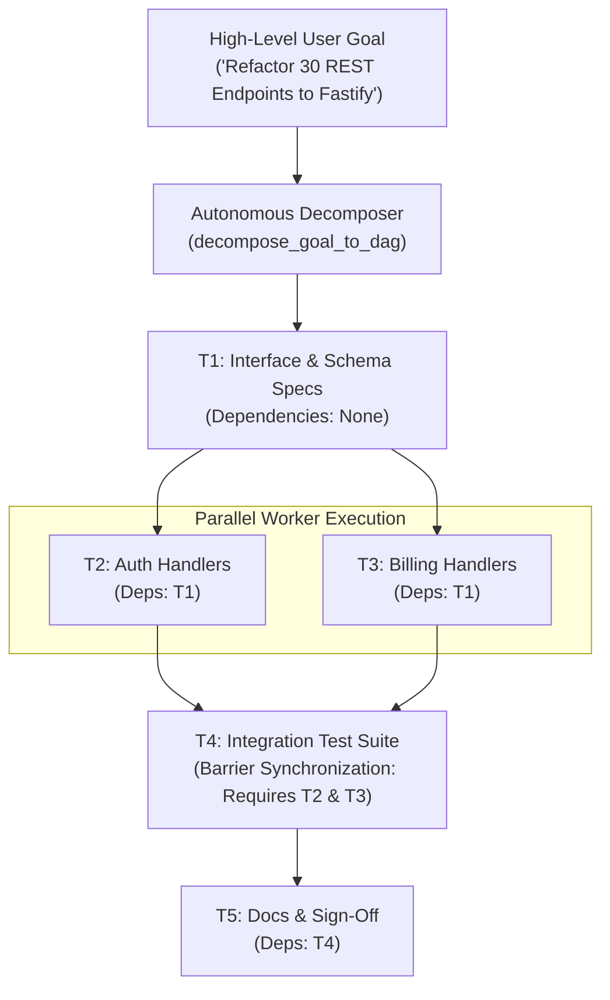

# Architecture: DAG Pipeline Engine

The Directed Acyclic Graph (DAG) Pipeline Engine manages goal decomposition, dependency graphs, cycle prevention, and topological scheduling.

---

## 1. Topological Scheduling Pipeline

---

## 2. Dependency Resolution & Barrier Synchronization

A task transitions to `READY` status if and only if:
1. Its current status is `PENDING`.
2. Every task ID in its `dependencies` array has achieved status `MERGED` or `COMPLETED`.

This guarantees that downstream workers never build against unverified or half-implemented upstream code.

---

## 3. Cycle Detection
Fleet runs a depth-first search (DFS) with 3-color node tracking (white, grey, black) upon every graph modification. If a circular dependency is detected, Fleet immediately rejects the task with `CycleDetectedError` to prevent agent deadlocks.
