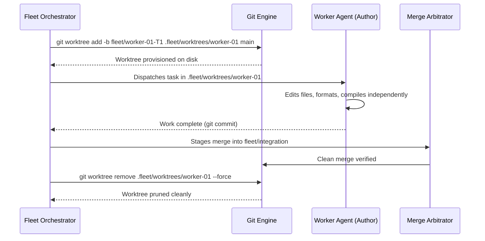

# Architecture: Git Worktree Multiplexer

The Worktree Multiplexer eliminates file-lock contention and merge conflicts by giving each worker agent an isolated physical directory on disk.

---

## 1. The Worktree Lifecycle

---

## 2. Disk Isolation Guarantees

* **Zero File Contention:** 10 workers can run `npm install`, compile TypeScript, or run formatters concurrently without file locks or index race conditions.
* **Zero Accidental Commits to Main:** All work occurs on isolated branches (`fleet/worker-<id>-<task>`).
* **Clean Teardown:** Once merged, `prune_worktree` removes temporary directories and runs `git worktree prune`.
